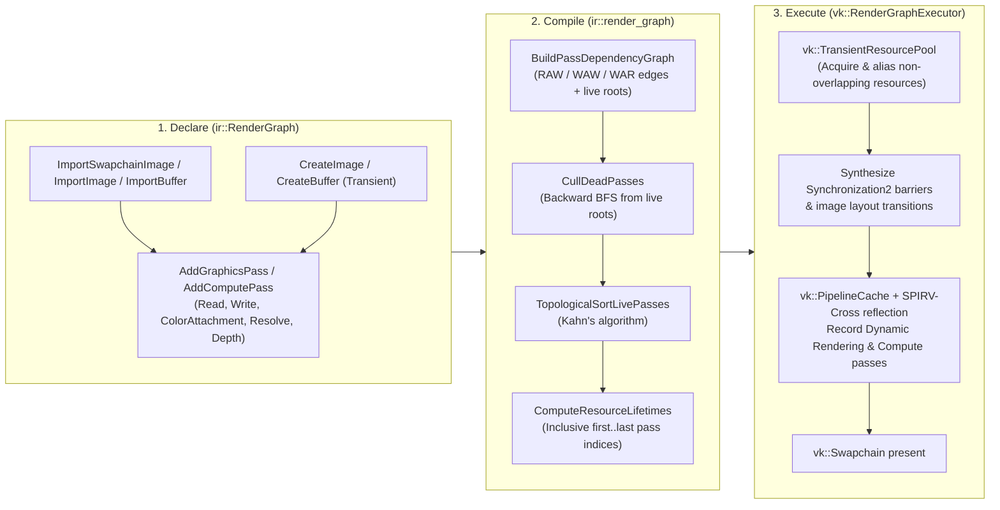
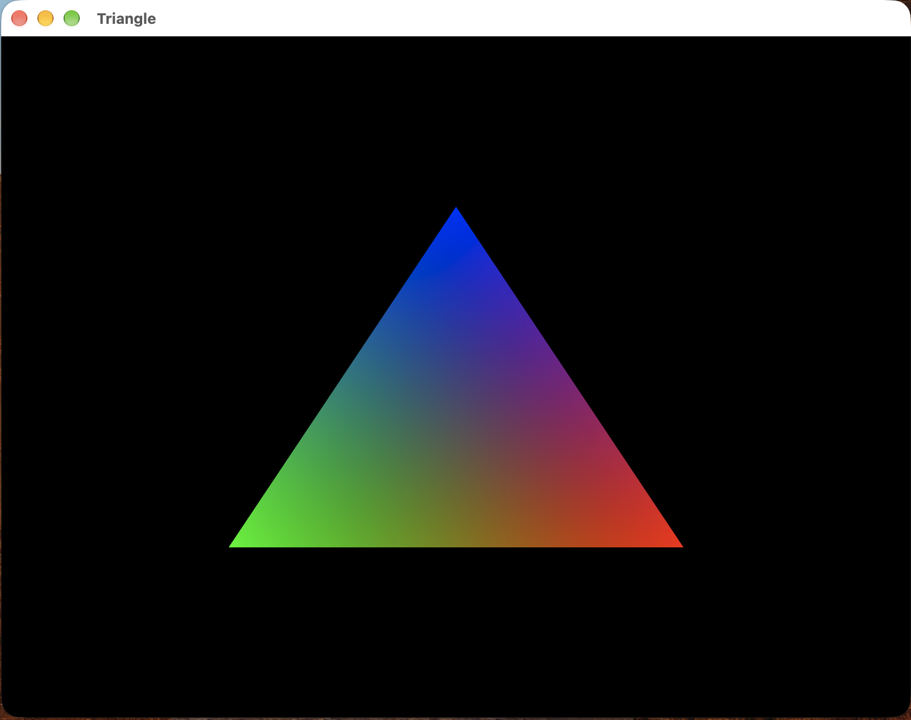
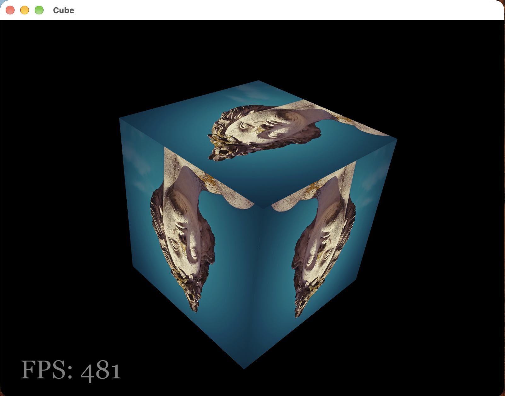
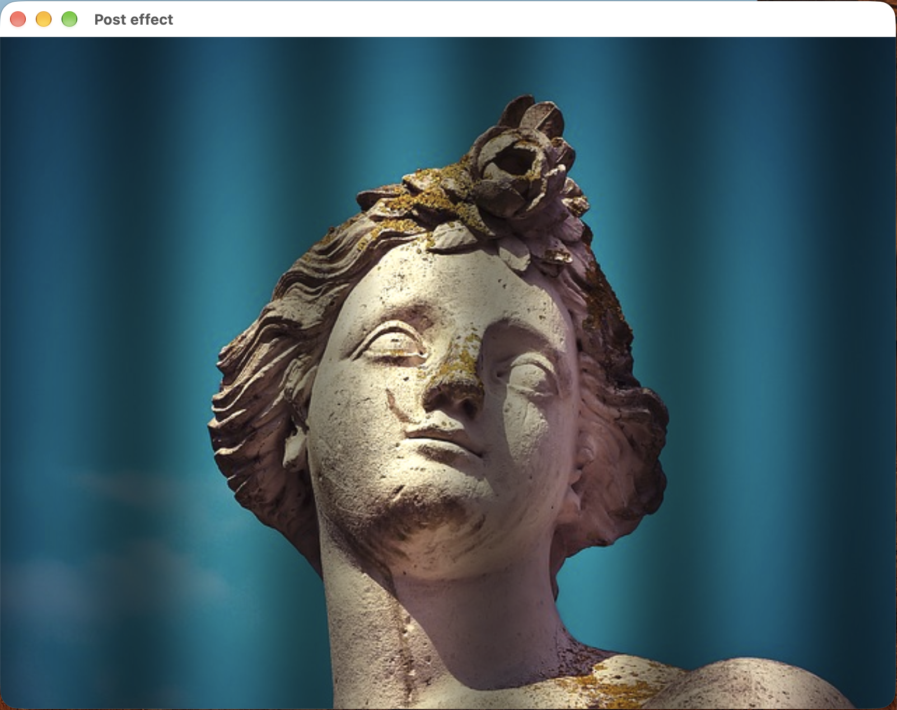
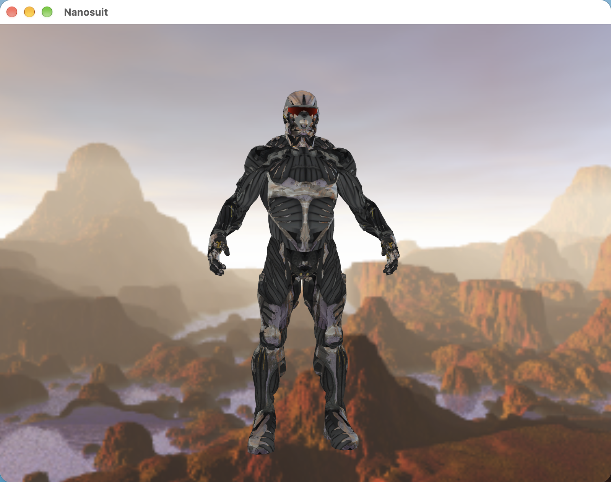
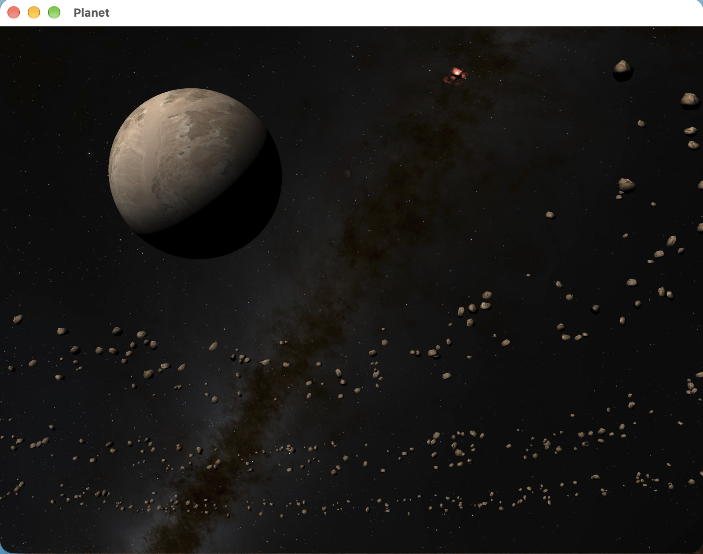
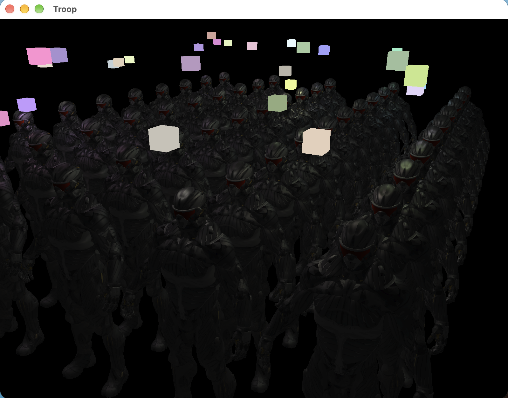
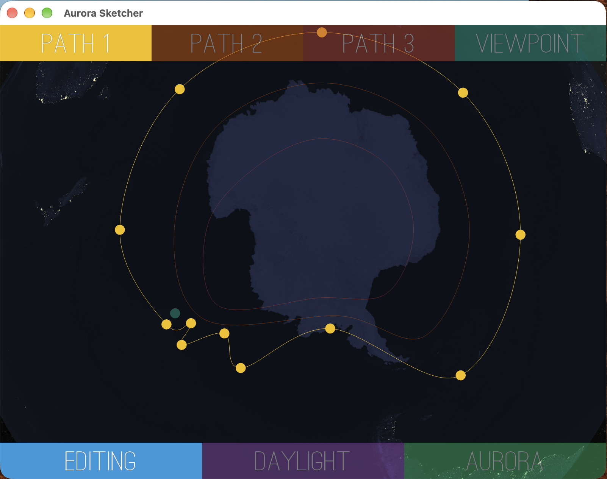
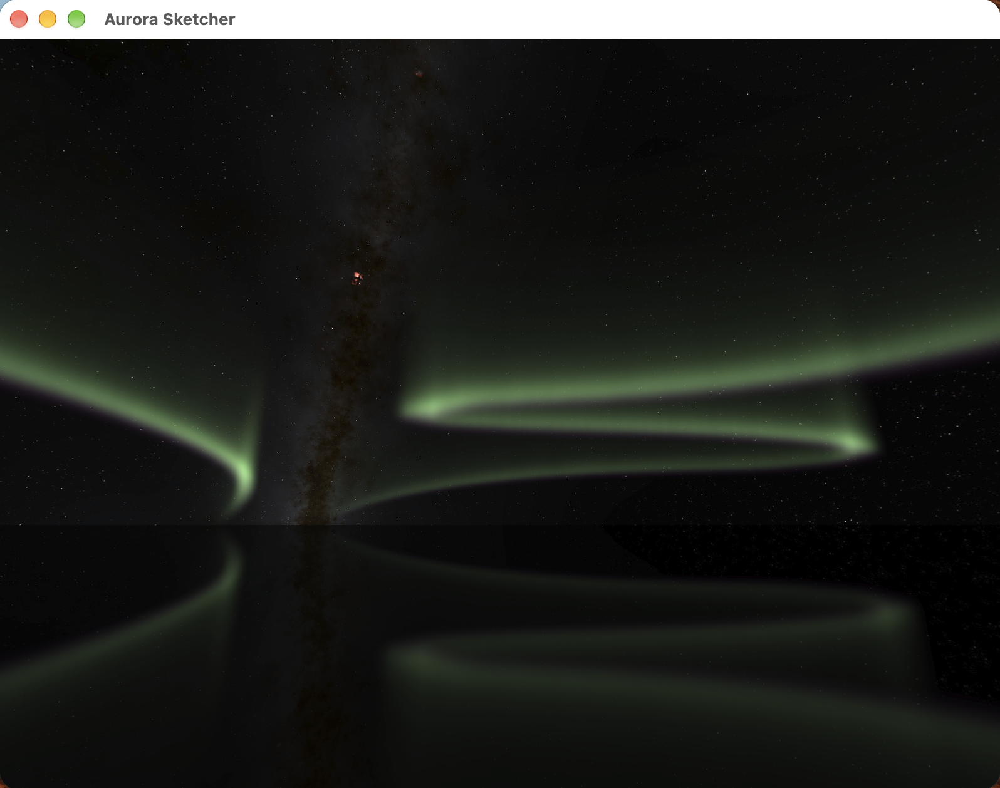

# Lighter

A lightweight C++20 Vulkan rendering engine built around a declarative **Frame Graph** (`ir::RenderGraph`), automatic Synchronization2 barrier synthesis, Dynamic Rendering, SPIR-V reflection, and transient resource pooling.

---

## Architecture

### Directory Layout

| Directory | Role |
| :--- | :--- |
| [`lighter/base/`](lighter/base) | Foundational non-GPU utilities: logging/assertions (`util`), CLI flags (`flag`), byte buffers & std140 alignment macros (`data`), asset/shader path lookup & `.obj` loading (`file`), image I/O (`image`), timers (`timer`), cache helpers (`ref_count`), and GLFW windowing (`window`). |
| [`lighter/renderer/`](lighter/renderer) | Core rendering engine split into the backend-agnostic Frame Graph IR ([`ir/`](lighter/renderer/ir)) and the Vulkan 1.3 implementation ([`vk/`](lighter/renderer/vk)). |
| [`lighter/scene/`](lighter/scene) | High-level 3D scene building blocks layered on `renderer/ir`: Assimp model loading & multi-mesh rendering (`model_loader`, `model`), `Skybox`, cameras (`camera`), sphere arcball rotation (`rotation`), Catmull-Rom/Bezier splines (`spline`), GPU Jump Flooding distance fields (`distance_field`), `Scene` interface, and app/render-pass helpers (`util.h`). |
| [`lighter/ui/`](lighter/ui) | Screen-space 2D overlays layered on `renderer/ir`: FreeType glyph atlas builder (`char_lib`), `StaticText` / `DynamicText` (`text`, `text_util`), and atlas-baked interactive `Button` / `ButtonMaker` widgets (`button`, `button_maker`). |
| [`lighter/shader/`](lighter/shader) | GLSL shader sources, compiled `.spv` binaries (`shared/` utilities + per-demo folders), and [`compiler/`](lighter/shader/compiler) (`compile_shaders` incremental build-time `shaderc` compiler tracked via SHA-256 `.compilation_record`). |
| [`lighter/example/`](lighter/example) | Seven runnable demos composing `base`, `renderer`, `scene`, and `ui`. |

### `ir/` vs. `vk/` Division

- **`lighter/renderer/ir/` (Backend-agnostic interface & graph compiler)**
  - Defines pure C++ interfaces and value descriptors with **zero Vulkan headers**: `ir::Renderer`, `ir::Buffer`, `ir::Image`, `ir::BufferUsage`, `ir::ImageUsage`, `ir::GraphicsPipelineDescriptor`, `ir::ComputePipelineDescriptor`, and `ir::RenderGraph`.
  - Implements graph analysis in `render_graph.cc` and `render_graph_util.cc` (dependency edges, dead-pass culling, topological sort, resource lifetime calculation, and Graphviz DOT export), making the Frame Graph logic directly unit-testable without a GPU.
- **`lighter/renderer/vk/` (Vulkan 1.3 execution backend)**
  - Implements `ir::Renderer` (`vk::Renderer`) on top of `vk::Context` + Vulkan Memory Allocator (VMA), `vk::Swapchain`, `vk::PerFrameCommand`, `vk::TransientResourcePool`, and `vk::PipelineCache`.
  - Uses **SPIRV-Cross** inside `vk::pipeline` to reflect descriptor bindings and push-constant ranges directly from `.spv` shaders, eliminating manual descriptor set layout boilerplate.
  - Executes `ir::RenderGraph` via `vk::RenderGraphExecutor` using **Dynamic Rendering** (`vkCmdBeginRendering`) and **Synchronization2** (`vkCmdPipelineBarrier2`).

### Frame Graph Lifecycle

Each frame declares passes and virtual resource versions into `ir::RenderGraph`, compiles the DAG, and hands it to `vk::RenderGraphExecutor`:



1. **Declare:** Passes consume and produce versioned virtual handles (`ImageHandle`, `BufferHandle`), separating graph topology from GPU allocation and barrier state.
2. **Compile:** `Compile()` extracts producer/consumer (RAW/WAW) and anti-dependency (WAR) edges, prunes passes that cannot reach an external resource or side-effect root, produces a deterministic execution order, and computes lifetimes `[first_pass, last_pass]`.
3. **Execute:** `RenderGraphExecutor::Execute()` allocates or aliases physical images/buffers in `TransientResourcePool`, emits minimal Synchronization2 pipeline barriers and layout transitions per resource version, binds cached graphics/compute pipelines with push descriptors (`VK_KHR_push_descriptor`), and records everything into the active frame's command buffer. `Renderer::last_render_graph_graphviz()` exports the compiled graph annotated with synthesized barriers.

---

## Building & Testing

### Prerequisites

- CMake `>= 3.24` and a C++20 compiler
- **Vulkan SDK** (`VULKAN_SDK` set in environment; requires `shaderc_combined` and Vulkan 1.3 headers/loader)
- Git (CMake `FetchContent` fetches `glfw`, `glm`, `freetype`, `assimp`, `VulkanMemoryAllocator`, `spirv_cross`, `googletest`, `stb`, `picosha2`, and runtime assets from `lun0522/resource` if not present locally)

### Configure, Build, and Run Unit Tests

```zsh
cmake -S . -B build
cmake --build build
ctest --test-dir build --output-on-failure
```

Building automatically compiles `compile_shaders` and updates any modified GLSL shaders under `lighter/shader/` into `.spv`.

Helpful CMake options:
- `-DLIGHTER_RESOURCE_DIR=/path/to/resource`: point to an existing local asset directory (by default CMake also checks `../resource`).
- `-DLIGHTER_FETCH_RESOURCE=OFF`: disable automatic download of runtime assets.

---

## Running the Examples

All examples run **uncapped** by default (`Mailbox -> Immediate -> FIFO` fallback) and accept common runtime flags:
- `--vsync`: cap presentation rate to display refresh using FIFO VSync
- `--resource_dir=<path>`: override runtime asset directory (`models`, `textures`, `fonts`)
- `--shader_dir=<path>`: override compiled shader directory

### 1. Triangle

Animated alpha-blended RGB triangle showcasing basic Frame Graph setup, MSAA resolve, and push constants.

```zsh
./build/lighter/example/example_triangle
```



### 2. Cube

Rotating textured cube using `scene::ModelBuilder`, `ui::StaticText`, and `ui::DynamicText` to render a live FPS counter.

```zsh
./build/lighter/example/example_cube
```



### 3. Post Effect

Multi-pass pipeline (`Graphics -> Compute -> Graphics`) applying a `sine_wave.comp` image-processing filter to a texture via Frame Graph transient images.

```zsh
./build/lighter/example/example_post_effect
```



### 4. Nanosuit

Multi-mesh Assimp `.obj` model with diffuse, specular, reflection, and cubemap environment reflections rendered alongside `scene::Skybox`.

```zsh
./build/lighter/example/example_nanosuit
```

*Controls:* mouse to look around, scroll wheel to zoom, arrow keys to move, `Esc` to quit.



### 5. Planet
1,500 instanced asteroids orbiting a lit planet inside a universe skybox (`AddPerInstanceBuffer` + `scene::Skybox`).

```zsh
./build/lighter/example/example_planet
```

*Controls:* mouse to look around, scroll wheel to zoom, arrow keys to move, `Esc` to quit.



### 6. Troop

Deferred shading across 50 instanced nanosuit models lit by 32 moving point-light cubes: Geometry Pass writes 3 G-buffer attachments + depth/stencil (`kStore`), and Lighting Pass uses stencil masking + sampled G-buffers.

```zsh
./build/lighter/example/example_troop
```

*Controls:* mouse to look around, scroll wheel to zoom, arrow keys to move, `Esc` to quit.



### 7. Aurora Sketcher

Interactive two-scene application (`Editor` and volumetric ray-traced `Viewer`), inspired by [*Interactive Volume Rendering Aurora on the GPU*](http://wscg.zcu.cz/WSCG2011/!_2011_J_WSCG_1-3.pdf) (Lawlor & Genetti, *Journal of WSCG*, Vol. 19, 2011). Whereas the original paper rendered pre-authored paths from off-planet, Aurora Sketcher lets you sculpt aurora paths interactively on Earth and inspect them from any surface viewpoint.

```zsh
# Start in the interactive Earth & spline Editor
./build/lighter/example/aurora/example_aurora

# Jump straight into the volumetric Aurora Viewer
./build/lighter/example/aurora/example_aurora --start_in_viewer
```



*Editor controls:* drag Earth to rotate, scroll wheel to zoom; click `Path 1`–`Path 3` or `Viewpoint` + `Editing` to add/move control points (left-click) or delete control points (right-click); toggle `Daylight` for day/night Earth textures; click `Aurora` to dump splines, run compute Jump Flooding distance fields (`scene::DistanceFieldGenerator`), and transition to the Viewer.



*Viewer controls:* mouse to look around the starry sky & airglow reflection, scroll wheel to zoom FOV, `` ` `` (backquote) to toggle between the 3D aurora view and the dumped 2D path image, `Esc` to return to the Editor.

#### Implementation & Algorithms

- **On-Sphere Spline Editing (`editor/`):** Earth rotation uses arcball sphere dragging with momentum/damping (`scene::rotation`). Aurora curtains are represented as closed **centripetal Catmull-Rom splines** (`scene::CatmullRomSpline`), adaptively subdivided onto the unit sphere (`aurora_layer_`) within a geometric roughness threshold so users can insert, drag, and remove control points directly in 3D.
- **2D Path Dumping & Jump Flooding Distance Field (`viewer/path_dumper.*`):** When switching to the Viewer, an offscreen `RenderGraph` rasterizes the 3D splines within a 24° FOV tangent-plane projection (`aurora_proj_view`) at 1024×1024 with MSAA, widens the line strips in a compute pass, and runs multi-pass **Jump Flooding Algorithm (JFA)** compute shaders (`scene::DistanceFieldGenerator`) to generate a 2D Euclidean distance field (`DistanceField`).
- **Distance-Field-Accelerated Volumetric Ray Marching (`aurora.frag`):** For each view ray (and mirrored ground reflection), the fragment shader computes ray–sphere shell intersections for the `85 km`–`300 km` aurora layer, projects 3D sample points into the dumped 2D path plane, and marches with adaptive steps (`max(dist * dist_step_scale, min_dt)`) using the JFA distance field to leap across empty space. Following Lawlor & Genetti's factored emission model, each sample multiplies the 2D path intensity by a 1D altitude energy deposition profile (`aurora_deposition`), applies soft peak-channel brightness compression, and blends atmospheric airglow and attenuation from a precomputed lookup table (`air_transmit_table`).
